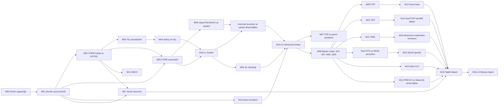

# F-16C Block 50 RL Eğitim Müfredatı

## 1. Amaç ve kapsam

Bu müfredatın amacı, F-16C Block 50 (yaklaşık 2007 konfigürasyonu) yeteneklerini sanal bir ortamda kullanabilen hiyerarşik bir pekiştirmeli öğrenme (RL) ajanı yetiştirmektir. Ana eğitim ortamı **headless JSBSim**, görselleştirme ve debug aracı **FlightGear** olarak sabitlenmiştir. `DCS F-16C Early Access Guide EN.pdf` yalnızca uçak, kokpit, aviyonik, sensör, seyrüsefer, haberleşme, savunma ve sanal silah kullanım yeteneklerinin kapsam referansıdır.

JSBSim tek yetkili fizik/state kaynağıdır; FlightGear eğitim state’i, reward veya test oracle’ı olamaz. Ayrıntılı entegrasyon sözleşmesi `JSBSIM_FLIGHTGEAR_MIMARISI.md` dosyasındadır. Müfredat:

- belirli bir simülatör komutuna veya ekran koordinatına bağlanmaz;
- her yeteneği gözlem, eylem, senaryo ve kabul testi üzerinden tanımlar;
- DCS menüleri yerine simülatörde bulunması gereken eşdeğer davranışı tarif eder;
- yalnızca sanal eğitim ve değerlendirme içindir;
- kılavuzdaki bütün operasyonel özellikleri kapsar; ayrıntılı izlenebilirlik matrisi `F16C_KILAVUZ_KAPSAM_MATRISI.md` dosyasındadır.

Referans kılavuz sürümü: **16 Ağustos 2026, 774 sayfa**. Kılavuzun kendisi, hava-yer bölümünün ileride güncelleneceğini belirtir. Bu nedenle kılavuz sürümü değiştiğinde kapsam matrisi yeniden denetlenmelidir.

## 2. JSBSim tabanlı eğitim sözleşmesi

Bir özellik JSBSim veya repo içindeki headless sistem uzantısında gözlenebilir, eyleme geçirilebilir ve otomatik ölçülebilir olmadan "uygulanabilir" kabul edilmez. FlightGear’da yalnız görünür olması yeterli değildir.

### 2.1 Gözlem kanalları

| Kanal | Asgari içerik | İlke |
|---|---|---|
| Uçuş durumu | konum, yönelim, açısal hızlar, IAS/Mach, irtifa, dikey hız, AoA, G, yakıt | Dağıtım politikasına yalnızca pilotun göstergelerden elde edebileceği bilgi verilir. |
| Uçak sistemleri | motor, hidrolik, elektrik, EPU, yakıt, iniş takımı, fren, kapaklar, speedbrake, trim, ikazlar | Arızalar ve gecikmeler modellenebilir olmalıdır. |
| Kokpit/aviyonik | HUD, ICP/DED, MFD sayfaları, seçili master mode, SOI, SPI, SMS/DTE durumu | Ekran görüntüsü, yapılandırılmış veri veya ikisinin birlikte kullanımı mümkündür. |
| Sensörler | FCR, TGP, HTS, HMCS, RWR, datalink çıktıları | Gizli dünya durumu doğrudan politikaya verilmez. |
| Haberleşme | UHF/VHF, TACAN/ILS, TNDL mesajları | Paket kaybı, gecikme ve yanlış/eksik bilgi senaryoları desteklenir. |
| Görev bağlamı | görev hedefi, ROE, rota, tehdit ve yük konfigürasyonu | Sadece brifing/DTC ile sağlanan bilgi görünürdür. |
| Ayrıcalıklı eğitim durumu | gerçek hedef/tehdit konumu, fizik hatası, temas kimliği | Yalnız öğretmen, critic ve skorlayıcı içindir; dağıtım politikasına sızamaz. |

### 2.2 Eylem kanalları

| Kanal | Asgari eylemler |
|---|---|
| Uçuş | pitch, roll, yaw, throttle, wheel brake, NWS, speedbrake, trim |
| Uçak konfigürasyonu | gear, canopy, anti-ice, lights, fuel, engine start/stop, EPU, electrical, avionics power |
| HOTAS | SSC ve throttle üzerindeki TMS/DMS/CMS/trim/trigger/weapon-release/cursor/antenna/range/comm işlevleri |
| Aviyonik | ICP/DED veri girişi, MFD OSB, master mode, SOI/SPI, HUD/HMCS ayarları, DTE yükleme |
| Sensör | FCR/TGP/HTS/HMCS seçimi, slew, designate, track, radar/laser/RF yönetimi |
| Haberleşme | UHF/VHF/TACAN/ILS/TNDL ayarı, mesaj gönderme/alma, wingman komutları |
| Stores/sanal silah | SMS envanter, seçme, fuze/profil, arm/safe, release/trigger, selective/emergency jettison |
| Savunma | RWR handoff, CMDS programı, chaff/flare, ECM modu ve jammer yönetimi |

### 2.3 Zaman ve kontrol katmanları

Başlangıç profili JSBSim physics için 120 Hz, uçuş policy’si için 20 Hz’dir; değerler yakınsama testinden sonra sabitlenir. Kontrol mimarisi üç katmanlıdır:

1. **Uçuş denetleyicisi:** sürekli kontrol, kısa ufuk; hedef roll/bank, pitch, heading, hız, irtifa ve dikey hız komutlarını stick, rudder, throttle ve speedbrake eylemlerine çevirir.
2. **Yetenek politikası:** saniyeler mertebesinde; `GOTO`, `LAND`, `REFUEL`, `TRACK` gibi beceri komutlarını hedef uçuş durumu, sensör ve aviyonik alt hedeflerine çevirir.
3. **Görev yöneticisi:** uzun ufuk; rota, yakıt, takım, abort/divert ve ileri görev kararlarını verir. Doğrudan kontrol yüzeyi komutu üretemez.

Her katman ayrı eğitilir, ardından dondurulmuş alt becerilerle bileşik görevlerde birleştirilir. Uçtan uca ince ayar, yalnız gerileme testleri geçildiğinde yapılır.

### 2.4 Skill Interface Contract

Katmanlar serbest biçimli mesajlarla değil sürümlenmiş sözleşmelerle konuşur.

| Üreten katman | Tüketen katman | İzin verilen çıktı örneği | Yasak çıktı örneği |
|---|---|---|---|
| Görev yöneticisi | Yetenek politikası | `GOTO waypoint_3`, `LAND runway_18`, `DIVERT alternate_1` | `elevator=-0.08`, `throttle=0.74` |
| Yetenek politikası | Uçuş denetleyicisi | `heading=142 deg`, `altitude=16000 ft`, `speed=350 kt` | doğrudan aileron/elevator dizisi |
| Uçuş denetleyicisi | Simülatör adaptörü | normalize stick, rudder, throttle, speedbrake | görev veya hedef kimliği kararı |
| Durum kestirici | Tüm politika katmanları | zaman damgalı belief state, güven ve validity mask | gelecek veya gizli gerçek dünya durumu |

Her komut şu ortak alanları taşır: `command_id`, `issued_at`, `valid_until`, `goal`, `constraints`, `success_condition`, `abort_condition`. Alt katman `accepted`, `running`, `succeeded`, `failed` veya `aborted` durumunu ve neden kodunu döndürür.

### 2.5 Temporal state estimation

Gecikme, gürültü ve eksik ölçüm bulunan ortam kısmen gözlemlenebilir kabul edilir. Politika yalnız tek kare `state -> action` eşlemesine zorlanmaz. Simülatör seçildikten sonra üç aday karşılaştırılır:

- sabit uzunlukta frame stacking;
- GRU/LSTM tabanlı recurrent policy;
- ayrı state estimator/Kalman-benzeri belief state + feed-forward policy.

M00 kabul testleri sensor/actuator latency, noisy measurement, missing measurement, delayed command ve out-of-order timestamp senaryolarını içerir. Her gözlem validity mask ve yaş bilgisi taşır; stale veri güncelmiş gibi kullanılamaz.

### 2.6 Actuator ve action realism

Adaptör şu fiziksel sınırları açıkça uygular ve günlüğe yazar:

- action rate limit ve control-authority limiti;
- deadzone ve saturation;
- input smoothing;
- actuator latency;
- action repeat/hold;
- komut ve gerçek yüzey konumu arasındaki fark.

Yüksek frekanslı `+1/-1` salınımı gibi simülatör açıkları rate-limit, actuator modeli ve toplam variation metriğiyle engellenir. Politika yalnız sınırlı komutu değil, gerçekleşen actuator durumunu da gözler.

## 3. Başarı, güvenlik ve geçiş kapıları

### 3.1 Zorunlu metrikler

- görev başarı oranı;
- uçuş zarfı ihlali, yere/nesneye çarpma ve kontrol kaybı oranı;
- checklist doğruluğu ve adım sırası;
- irtifa, hız, rota, glideslope, formasyon ve tanker pozisyon hataları;
- yakıt/zaman verimliliği;
- sensör tespit, takip, teşhis ve yanlış teşhis oranları;
- dost/hasım ayrımı ve ROE ihlali;
- sanal atışlarda geçerli çözüm, isabet/etki ve gereksiz mühimmat kullanımı;
- tehditten sağ kalma ve görevi güvenli sonlandırma;
- daha önce öğrenilmiş becerilerde gerileme.

### 3.2 Beş kapılı kabul sistemi

Sayısal eşikler simülatörün fizik ve sensör doğrulamasından sonra kalibre edilecektir. Aşağıdakiler başlangıç hedefleridir:

| Kapı | Şart |
|---|---|
| K0 - Özellik mevcut | Gerekli gözlem/eylem/arıza/puanlama arayüzleri mevcut ve deterministik tekrar testi geçiyor. |
| K1 - Tek beceri | En az 200 değerlendirme bölümünde başarı >= %95; kritik emniyet veya ROE ihlali = 0. |
| K2 - Rastgeleleştirme | Başlangıç durumu, hava, ağırlık, yakıt ve sensör gürültüsü rastgeleleştirildiğinde başarı >= %90. |
| K3 - Bileşim | Beceri, en az üç öncül/ardıl beceriyle kesintisiz görevde başarı >= %85 ve önceki becerilerde >5 yüzde puan gerileme yok. |
| K4 - Dondurulmuş test | Eğitimde görülmeyen harita/rota/hava/tehdit/yük kombinasyonlarında başarı >= %80; kritik ihlal = 0. |

Kritik ihlaller ortalamayla gizlenmez. Çarpışma, dost ateşi, izinsiz sanal silah kullanımı, yanlış jettison, yerde silah kullanımı veya kontrolsüz uçuş ayrı "fail-closed" kapılarıdır.

## 4. Eğitim yöntemi

Her ders aynı altı bileşenle hazırlanır:

1. **Reset dağılımı:** kolaydan zora başlangıç durumları.
2. **Gözlem maskesi:** o derste ajanın görebildiği pilot-seviyesi bilgiler.
3. **Eylem maskesi:** öğretilen eylemler; diğerleri öğretmen veya güvenli otomasyon tarafından tutulabilir.
4. **Yoğun ödül:** yalnız öğrenmeyi hızlandıran ara sinyaller.
5. **Seyrek görev ödülü:** gerçek kabul kriterini temsil eder.
6. **Dondurulmuş sınav:** eğitim tohumlarından ve domain randomization dağılımından ayrıdır.

Nihai sistemin her parçası RL olmak zorunda değildir. Ayrıcalıklı simülatör durumu ödül ve critic için kullanılabilir; dağıtım politikasının girdisi olamaz.

### 4.1 Öğrenme yöntemi seçimi

| Yöntem | Kullanıldığı işler | Örnekler |
|---|---|---|
| RL | belirsizlik, sürekli kontrol veya uzun ufuklu karar | uçuş kontrolü, iniş, formasyon, enerji yönetimi, sensor tracking, divert/abort |
| Behavior cloning / imitation | insan prosedürünün başlangıç politikası | startup, shutdown, checklist, kokpit manipülasyonu |
| Deterministik FSM/script | sonucu ve doğru sırası tamamen tanımlı işlem | button sequence, mode initialization, veri girişi, configuration verification |
| Hibrit | deterministik prosedür + belirsiz karar/kontrol | ILS kurulumu script, yaklaşma ve go-around kararı RL |

Deterministik bir adımı RL ile yeniden keşfetmek varsayılan değildir. RL yalnız prosedür içindeki belirsiz seçim, hata toparlama veya sürekli kontrol kısmına uygulanır. Bütün yöntemler aynı feature ID, olay günlüğü ve frozen-test sistemiyle değerlendirilir.

### 4.2 Curriculum Manager

Scheduler her dersin zorluk seviyesini ve örnekleme dağılımını otomatik yönetir:

```text
current lesson
  -> rolling success >= K1 threshold
  -> difficulty +1
  -> randomized success >= K2 threshold
  -> frozen evaluation
  -> PASS
  -> next unlocked lesson
```

Varsayılan eğitim batch dağılımı:

- %70 mevcut ders;
- %20 doğrudan öncül dersler;
- %10 rastgele eski dersler.

Bu oranlar sabit bir dogma değildir. Herhangi bir geçmiş derste frozen başarı son kabul değerinden 5 yüzde puandan fazla düşerse scheduler:

1. yeni zorluğu artırmayı durdurur;
2. gerileyen dersi aktif replay havuzuna alır;
3. oranı geçici olarak `%50 current / %40 regressed / %10 old` yapar;
4. gerileyen ders K2 eşiğine dönmeden yeni ders kilidini açmaz.

Rolling başarı en az 200 bağımsız bölüm üzerinden ve Wilson güven aralığıyla raporlanır. Ders geçişi yalnız ortalama başarıya değil, güven aralığının alt sınırına ve kritik ihlal sayısının sıfır olmasına bağlıdır.

### 4.3 Zorluk eksenleri

Scheduler aynı anda yalnız bir veya iki ekseni zorlaştırır:

- başlangıç tutum/hız/irtifa sapması;
- hedef toleransı ve görev süresi;
- rüzgâr/türbülans;
- ağırlık/yakıt/konfigürasyon;
- sensör ve actuator gecikmesi/gürültüsü;
- arıza ve eksik ölçüm;
- çoklu hedef veya takım karmaşıklığı.

### 4.4 Eğitim kapsam sınıfları

Kılavuzda modellenen her özellik RL eğitim grafiğine girmek zorunda değildir:

| Sınıf | Anlam | İlk RTX 3060 hattındaki durum |
|---|---|---|
| CORE | güvenli kalkış-rota-iniş için zorunlu | eğitilir ve L1 mezuniyetini bloklar |
| OPTIONAL | yararlı fakat ilk milestone için zorunlu değil | L1 sonrasına ertelenir |
| ADVANCED | sensör, takım ve ileri görev yetenekleri | yalnız L2/L3 hattında açılır |
| REFERENCE_ONLY | ortamda modellenir veya oracle sağlar; ayrı politika becerisi değildir | RL dersi açılmaz |

Kapsam matrisindeki prefix tabanlı sınıflandırma ve istisnalar bu sınıfları bütün feature ID’lere uygular.

## 5. Önkoşul grafiği



## 6. Modüller

### M00 - Simülatör uygunluğu ve özellik doğrulama

Bu modül model eğitmez; pinlenmiş JSBSim ve F-16 modelinin sonraki modüller için geçerli olup olmadığını belirler. FlightGear yalnız debug/replay köprüsü olarak sınanır.

| Ders | İçerik | Kabul testi |
|---|---|---|
| M00.0 | JSBSim/FlightGear/F-16 kaynak, sürüm, lisans, dependency closure ve SHA-256 manifesti | Değişken `latest/master` referansı yok; bütün runtime dosyaları hash’li. |
| M00.1 | JSBSim 6-DOF uçuş, FBW/FCS, motor, yakıt, aerodinamik sürükleme, gear/speedbrake etkisi | FDM-G0 trim/envelope/stability ve sabit seed durum izi testleri geçer. |
| M00.2 | Kokpit, HUD, ICP/DED, MFD, HOTAS, DTE, autopilot | Kapsam matrisindeki her kontrol okunabilir ve uygulanabilir ya da eşdeğer API ile temsil edilir. |
| M00.3 | FCR, TGP, HTS, HMCS, RWR, CMDS, ECM, TNDL | Sensör görüş alanı, gecikme, gürültü, maskeleme ve arızalar puanlanabilir. |
| M00.4 | Sanal stores ve mühimmat modelleri | Her kılavuz store tipi yüklenebilir; release/launch, guidance, fuze ve etki telemetrisi gözlenebilir. |
| M00.5 | Headless senaryo, değerlendirme ve FlightGear izolasyonu | Seed/replay/log altyapısı vardır; FlightGear açık/kapalı state hash aynıdır. |
| M00.6 | Temporal observation testleri | Gecikme, dropout, stale/out-of-order veri ve validity mask deterministik olarak enjekte ve ölçülür. |
| M00.7 | Actuator/action modeli | Rate limit, deadzone, saturation, smoothing, latency, authority ve action-repeat doğrulanır. |

Çıkış: `SIM_CAPABILITY_MANIFEST` içindeki bütün zorunlu feature ID’leri `native`, `adapted` veya `missing` olarak işaretlenir. `missing` olan zorunlu özellik varken ilgili modül başlatılmaz.

### M01 - Temel uçuş ve enerji yönetimi

| Ders | Tekil beceriler | Ana ölçüt |
|---|---|---|
| M01.1 | Roll stabilization: `target_roll=0 deg`; diğer eksenler öğretmen tarafından tutulur | roll MAE, yerleşme süresi, control variation |
| M01.2 | Pitch stabilization: tek hedef pitch; roll/throttle sabitlenir | pitch MAE, overshoot, yerleşme süresi |
| M01.3 | Bank-angle tracking: farklı pozitif/negatif bank hedefleri | bank MAE, overshoot, roll-rate sınırı |
| M01.4 | Heading control: bank ve gerektiğinde rudder koordinasyonuyla hedef heading’e dönme | heading MAE, irtifa ve sideslip hatası |
| M01.5 | Altitude hold: pitch + throttle koordinasyonu | altitude MAE, dikey hız ve throttle variation |
| M01.6 | Airspeed hold: throttle + pitch koordinasyonu | IAS/Mach MAE, altitude coupling hatası |
| M01.7 | Climb/descent: hedef dikey hız ve irtifada level-off | vertical-speed MAE, level-off overshoot |
| M01.8 | Combined flight control: heading + altitude + speed | üç hedefin ortak normalize hatası ve constraint ihlali |
| M01.9 | Energy management: dönüş, tırmanış/alçalış, speedbrake ve konfigürasyon | specific-energy hatası, yakıt ve zarf marjı |
| M01.10 | Envelope recovery: yüksek AoA, stall yaklaşımı, overspeed ve aşırı sapma | güvenli zarfa dönüş süresi; kritik ihlal = 0 |
| M01.11 | Temporal state estimation altında kontrol | gecikme/dropout altında M01.8 başarısı ve belief kalibrasyonu |
| M01.12 | Yakıt, ağırlık, dış tank/store sürüklemesine uyarlama | farklı konfigürasyonda K2 |

İlk reset hedefi `target_roll=0 deg` kadar basittir. Birden fazla eksen M01.8’den önce aynı anda serbest bırakılmaz. Heading, altitude ve speed hedefleri tekil K1/K2 kapılarını geçmeden bileşik hedefe dönüşmez.

### M02 - Kokpit, göstergeler, HOTAS ve temel aviyonik

| Ders | Tekil beceriler |
|---|---|
| M02.1 | Instrument panel; AoA indexer, AR/NWS, eyebrow ışıkları, MISC/RF, SAI, fuel flow, engine, IAS/Mach, altimeter, AoA, VVI, ADI, fuel quantity |
| M02.2 | Sol/sağ yardımcı konsollar; landing gear, HMCS paneli, alternate gear, compass, PFLD, caution panel, hydraulic/EPU/cabin pressure/clock |
| M02.3 | Sol konsol; MPO, engine/jet start, EPU, electrical, audio, AVTR, fuel, IFF, exterior lights, flight control, trim, test, canopy/defog |
| M02.4 | Sağ konsol; sensor power, interior lights, air conditioning, secure/plain voice, oxygen, anti-ice/antenna, avionics power, voice message, zeroize, seat |
| M02.5 | Ejection seat kontrollerini tanıma; yalnız tanımlı acil durumlarda güvenli ejection kararı |
| M02.6 | SSC ve throttle üzerindeki bütün HOTAS işlevleri; bağlama göre doğru kısa/uzun basış ve eksen kullanımı |
| M02.7 | HUD sembolleri, HUD kontrol paneli ve bilgi önceliklendirme |
| M02.8 | ICP veri girişi; CNI, UHF, VHF, IFF, LIST; ALOW, CRUS TOS/RNG/HOME/EDR, TIME; BNGO, MAN, MODE ve MISC DED sayfaları |
| M02.9 | MFD master menu, sayfa seçimi ve MFD format yeniden atama |
| M02.10 | DTE MFD formatı ve veri yükleme/geri çağırma |
| M02.11 | Otopilot kontrol, ayar, devreye alma ve devreden çıkarma |

Değerlendirme: rastgele istenen bir kokpit durumu oluşturulur; ajan doğru göstergeden teşhis koyar ve yalnız gerekli kontrol dizisini uygular. Yanlış kritik anahtar kullanımı ayrı başarısızlıktır.

L1 için M02’nin tamamı zorunlu değildir. CORE alt küme; temel uçuş göstergeleri, gear/brake/speedbrake, yakıt, temel HUD ve uçuş HOTAS’ıdır. ICP/DED/MFD/DTE veri girişi varsayılan olarak deterministik FSM ile yürütülür. Nadir konsol kontrolleri OPTIONAL veya REFERENCE_ONLY kalır; yalnız arıza kararının belirsiz kısmı RL’e açılır.

### M03 - Yer prosedürleri

| Ders | Tekil beceriler | Ana ölçüt |
|---|---|---|
| M03.1 | before engine start, normal engine start, after engine start | sıra doğruluğu, limit ihlali, süre |
| M03.2 | normal ve stored-heading INS başlangıç entegrasyonu | kabul edilen alignment kalitesi |
| M03.3 | before taxi, taxi, NWS, wheel brake, yön/çizgi takibi | sapma, hız, fren sıcaklığı/hasar |
| M03.4 | after landing ve engine shutdown | doğru güvenli durum |
| M03.5 | ground support, normal/hot refuel ve rearm | yangın/konfigürasyon ihlali olmadan tamamlama |
| M03.6 | arıza, yanlış konfigürasyon ve abort dalları | fail-closed karar doğruluğu |

M03.1-M03.5 için varsayılan yöntem behavior cloning ile başlatılan FSM/checklist yürütücüsüdür. RL, yalnız zamanlama belirsizliği, taxi kontrolü, arıza teşhisi ve abort/continue kararında kullanılır.

### M04 - Kalkış, yaklaşma, iniş ve havada yakıt ikmali

| Ders | Tekil beceriler |
|---|---|
| M04.1 | before takeoff, normal takeoff, rotate/gear-up/climb |
| M04.2 | crosswind takeoff ve pist merkez hattı kontrolü |
| M04.3 | descent/before landing, overhead break, final ve normal landing |
| M04.4 | crosswind landing, go-around ve divert |
| M04.5 | tanker approach/rendezvous, pre-contact, contact formasyonu |
| M04.6 | yakıt transferi sırasında istasyon tutma |
| M04.7 | breakaway ve post-refueling checklist |

İniş sınavı farklı ağırlık, rüzgâr, görüş, pist, yakıt ve kısmi sistem arızalarında yapılır. Sadece teker koymak başarı değildir; yaklaşma stabilitesi, sink rate, AoA, touchdown zone ve pistte kalma birlikte puanlanır.

### M05 - INS, seyrüsefer verisi ve rota

| Ders | Tekil beceriler |
|---|---|
| M05.1 | INS initialization, INS DED, coarse/fine kaliteyi okuma |
| M05.2 | NORM gyrocompass, AUTO-NAV, NARF, resume ve alignment kabulü |
| M05.3 | STOR HDG, kesme/devam ve kabul |
| M05.4 | GPS destekli/desteksiz in-flight alignment; ATT mode |
| M05.5 | NAV STATUS, NAV COMMANDS, system altitude, DTS, AUTO ACAL |
| M05.6 | cursor slew düzeltmesi; position fix ve altitude calibration |
| M05.7 | HUD/FCR/TGP/OFLY position fix; RALT/FCR/HUD/TGP altitude calibration |
| M05.8 | steerpoint sembolleri ve türleri; STPT, MGRS, UTM DEST, DEST DIR, OA1/OA2 |
| M05.9 | steerpoint düzenleme, offset aimpoint ve MGRS-lat/lon dönüşümü |
| M05.10 | HUD/HMCS/FCR/TGP/OFLY markpoint oluşturma ve manuel düzenleme |
| M05.11 | Mission Editor’dan rota tanımı; HUD/HSD/EHSI ile rota takibi ve steerpoint seçimi |

L1 CORE seyrüsefer alt kümesi waypoint seçimi, tek waypoint tracking, çok waypoint rota, altitude/speed constraint ve yakıt rezervidir. Ayrıntılı INS düzeltme/kalibrasyon işlemleri OPTIONAL olarak L1 sonrasına bırakılır; deterministik sayfa/veri girişleri script ile yapılabilir.

### M06 - TACAN, ILS, radyo ve otopilotlu uçuş

| Ders | Tekil beceriler |
|---|---|
| M06.1 | TACAN kanal/band ayarı, tanımlama, radial ve EHSI TCN navigasyonu |
| M06.2 | air-to-air TACAN ve tanker rendezvous desteği |
| M06.3 | ILS localizer ayarı/tanımlama; glideslope intercept/descent, decision height |
| M06.4 | EHSI PLS, ADI ve HUD ile düşük görüş yaklaşması |
| M06.5 | comm management; UHF/VHF preset seçme/düzenleme ve manual frequency |
| M06.6 | UHF backup panel preset/manual tuning ve easy communication eşdeğeri |
| M06.7 | autopilot ile rota/irtifa tutma, güvenli disconnect ve pilot devralması |

### M07 - Görev planlama ve veri aktarımı

| Ders | Tekil beceriler |
|---|---|
| M07.1 | DTC Manager; görev grubuna yükleme, DTC tabı ve görev sırasında çağırma |
| M07.2 | MPD NAV PTS, GEO LINES, THREAT PTS, DEST PTS, ROE, CMDS |
| M07.3 | NAV RTE 1-3, VIP/VRP planlama |
| M07.4 | COMM 1/2 planlama |
| M07.5 | ELINT/RWR threat table planlama |
| M07.6 | MFD/FCR, HSD/HAD ve MISC renk/sembol ayarları |
| M07.7 | bozuk/eksik DTC’yi fark etme, güvenli manuel düzeltme veya görevi iptal |

### M08 - Taktik aviyonik arayüzü

| Ders | Tekil beceriler |
|---|---|
| M08.1 | NAV, A-A, A-G, MSL, DGFT, selective JETT, emergency JETT master modları |
| M08.2 | MFD formatlarını SSC ile döndürme; SOI atama/değiştirme |
| M08.3 | SPI: pre-planned, visual, weapon pipper ve airborne target kaynakları |
| M08.4 | PRE/VIS weapon delivery; sighting point, STP/TGT, OA1/OA2, IP, RP |
| M08.5 | navigation/VIP/VRP/markpoint/HMCS/visual/snowplow cursor ve cursor zero |
| M08.6 | snowplow giriş/çıkış; post-designate ve pre-designate davranışı |
| M08.7 | VRP: TGT-to-VRP/PUP, overflight designation, cursor alignment |
| M08.8 | VIP: VIP-to-TGT/PUP ve overflight designation |
| M08.9 | bullseye/BULL DED |
| M08.10 | HSD format, CNTL sayfaları, EXP ve zoom |
| M08.11 | SMS INV, store code, selective jettison ve emergency jettison |

### M09 - APG-68 FCR

| Ders | Tekil beceriler |
|---|---|
| M09.1 | radar activation, RF switch, STBY/OVRD ve emission discipline |
| M09.2 | slew/track, display, bar scan, mini-search, azimuth/range/elevation, spotlight |
| M09.3 | space/body stabilization; pulse/pulse-Doppler, scan frame, jamming interference kavrayışı |
| M09.4 | A-A/A-G format, mode menu, CNTL, target symbols ve TOI |
| M09.5 | CRM RWS, VSR, TWS; system/cursor/bugged target yönetimi |
| M09.6 | SAM, DT SAM, DTT, STT ve EXP |
| M09.7 | ACM 30x20, 10x60, BORE, HMCS-cued BORE ve SLEW |
| M09.8 | NCTR sembol/kod ve AIFF ile kimlik değerlendirmesi |
| M09.9 | GM, EXP, DBS1/DBS2, freeze ve FTT |
| M09.10 | GMT/GMTT, SEA ve AGR |

### M10 - AAQ-33 gelişmiş hedefleme podu

| Ders | Tekil beceriler |
|---|---|
| M10.1 | activation, STBY/OVRD, FLIR, TV, PIP, variable/XR zoom |
| M10.2 | slew/slave; area, point ve inertial track |
| M10.3 | sensor management, XR processing, orientation ve TGP format/CNTL |
| M10.4 | LASR DED, dual-mode laser, manual/automatic laser ranging/designation |
| M10.5 | A-G multi-target list ekleme/seçme/slew/silme |
| M10.6 | LST ve başka bir laser designation edinme |
| M10.7 | IR pointer |
| M10.8 | MASK ve CHECK ATTITUDE advisory tepkileri |
| M10.9 | A-A mode, A-A multi-target, laser ranging ve AIM-9 slave |

### M11 - Tactical Net Datalink

| Ders | Tekil beceriler |
|---|---|
| M11.1 | ağ, fighter/mission channels, fighter-to-fighter ve surveillance/C2 mesajları |
| M11.2 | MIDS initialization; NET STATUS, TNDL ve STN DED sayfaları |
| M11.3 | manuel sync; ownship ve flight/team STN düzenleme; mission options |
| M11.4 | PPLI, STF, onboard/offboard ve track-number correlation, ATDT |
| M11.5 | fighter air target, surveillance track, PDLT ve FCR declutter |
| M11.6 | seçili steerpoint veya FCR/TGP SPI markpoint gönderme/alma |
| M11.7 | SEAD target gönderme/alma |

### M12 - ASQ-213 HTS ve SEAD hedefleme

| Ders | Tekil beceriler |
|---|---|
| M12.1 | activation, slew/designation ve pasif RF algılama |
| M12.2 | radio direction finding, triangulation ve AOA geolocation |
| M12.3 | TDOA geolocation; master/slave rolleri |
| M12.4 | HAD format, THRT, CNTL 1/2, EXP ve HTS DED |
| M12.5 | AOA ranging, TDOA ranging ve SEAD DED |
| M12.6 | TDOA sub-team kurma; master/slave prosedürleri |

### M13 - Joint Helmet-Mounted Cueing System

| Ders | Tekil beceriler |
|---|---|
| M13.1 | HMCS activation ve semboller |
| M13.2 | display/align DED ayarları |
| M13.3 | HMCS alignment ve kalite doğrulama |
| M13.4 | HMCS ile markpoint, radar cueing, TGP cueing ve AIM-9 boresight |

### M14 - Hava-hava sensör ve sanal silah kullanımı

| Ders | Tekil beceriler |
|---|---|
| M14.1 | air-combat preparation ve master mode seçimi |
| M14.2 | M61 EEGS Level 5 FCR solution ve Level 2 visual solution |
| M14.3 | AIM-9P/P3, L/M/P5 ve X varyantlarını ayırma; SLAVE/BORE |
| M14.4 | SRM HUD/HMCS/MFD sembolleri, ses tonları ve SMS AAM sayfası |
| M14.5 | AIM-9 FCR cue, TGP cue, HMCS BORE ve uncued BORE sanal angajmanları |
| M14.6 | AIM-120 guidance; SLAVE/BORE ve MRM HUD/HMCS/MFD/SMS sembolleri |
| M14.7 | AIM-120 single target SAM/STT |
| M14.8 | AIM-120 dual target DT SAM/DTT |
| M14.9 | AIM-120 multi-target TWS |
| M14.10 | AIM-120 visual BORE |

Her sanal silah sınavında önce kimlik, ROE, menzil/çözüm ve friendly-separation doğrulanır. Sadece hedefe isabet etmek başarı değildir.

### M15 - Dallandırılmış hava-yer sensör ve sanal silah kullanımı

| Ders | Hat | Önkoşul | Tekil beceriler |
|---|---|---|---|
| M15.1 | Ortak | M08 | attack preparation, pre-combat checks ve abort kriterleri |
| M15.2 | Basic A-G | M08 | M61 strafe ve in-range cue update |
| M15.3 | Basic A-G | M08 | 2.75-inch rocket CCIP |
| M15.4 | Basic A-G | M08 | general-purpose, cluster ve training bomb ayrımı; SMS sayfası |
| M15.5 | Basic A-G | M08 | unguided bomb CCIP, post-designate CCIP ve CCRP |
| M15.6 | Sensor-guided | M10 | Paveway II/III; terminal laser code, SMS ve LGB CCRP |
| M15.7 | Sensor-guided | M08; TGP yalnız VIS designation gerekiyorsa | JDAM SMS/CNTL/HUD; PRE ve VIS |
| M15.8 | Sensor-guided | M08; TGP yalnız VIS designation gerekiyorsa | JSOW SMS/HUD; PRE ve VIS |
| M15.9 | Sensor-guided | M08; TGP yalnız VIS designation gerekiyorsa | WCMD SMS/HUD/CNTL; PRE ve VIS |
| M15.10 | SEAD-specific | M12 | AGM-88 hazırlık, HARM DED, SMS/WPN/HUD |
| M15.11 | SEAD-specific | M12 | HARM HAS; POS EOM/PB/RUK sanal kullanım |
| M15.12 | Sensor-guided | M08 | AGM-65 operation/limitations, SMS/CNTL/WPN ve automatic power-on |
| M15.13 | Sensor-guided | M08; TGP gerekmez | Maverick boresight ve PRE/VIS/BORE |
| M15.14 | Sensor-guided | M10 yalnız TGP handoff için | Maverick TGP handoff, ripple fire ve force correlate |

M15 değerlendirmeleri farklı hedef türü, koordinat hatası, rüzgâr, maskeleme, collateral alanı, hareket ve sensör arızaları içerir. Geçersiz/şüpheli çözümde `no-release` doğru davranıştır.

### M16 - Formasyon, takım ve taktik datalink bileşimi

| Ders | Tekil beceriler |
|---|---|
| M16.1 | line abreast, trail, wedge, echelon left/right, finger four, spread four |
| M16.2 | lider/wingman istasyon tutma ve rol değişimi |
| M16.3 | engaged fighter/supporting fighter koordinasyonu |
| M16.4 | datalink markpoint, track ve SEAD mesajıyla ortak görev |
| M16.5 | haberleşme/datalink kaybında önceden brifinglenmiş fallback |

M16.1-M16.2 basic formation hattıdır ve M01.8-M01.9’dan sonra açılır; datalink önkoşulu yoktur. M16.3-M16.5 advanced cooperative formation hattıdır ve M11 ile haberleşme/datalink becerilerini gerektirir.

### M17 - Savunma sistemleri ve hayatta kalma

| Ders | Tekil beceriler |
|---|---|
| M17.1 | RWR/TWAI sembolleri; threat prime/aux kontrolleri ve handoff |
| M17.2 | ALIC; hava savunma, deniz, hava radarları ve diğer tehdit sembolleri |
| M17.3 | CMDS paneli; BINGO, CHAFF/FLARE, OTHER1/2 DED sayfaları |
| M17.4 | programlı ve manuel chaff/flare, kaynak/bingo yönetimi |
| M17.5 | ECM panel; noise/deception jamming, burnthrough ve doğru kullanım zamanı |
| M17.6 | radar/IR tehditlerine karşı maneuver + CMDS + ECM bileşimi |
| M17.7 | tehdit sınıfına göre evade, continue, abort veya divert kararı |

M17.1-M17.4 temel savunma hattı M01 ve CORE M02’den sonra açılabilir; FCR önkoşulu yoktur. Sensör füzyonu ve ileri taktik bileşim, ilgili M09-M13 modüllerinden sonra açılır.

### M18 - Taktik görev profilleri

| Ders | Tekil beceriler |
|---|---|
| M18.1 | BVR detection, commit, engagement ve defense |
| M18.2 | WVR positional/attack geometry, turn rate-radius, merge |
| M18.3 | air-to-surface objective, threat, terrain ve weather değerlendirmesi |
| M18.4 | high-altitude level ve dive bombing profilleri |
| M18.5 | low-altitude level/retarded ve pop-up dive profilleri |
| M18.6 | standoff toss ve missile/glide-bomb delivery profilleri |
| M18.7 | ingress/egress, fence check ve yakıt/tehdit tabanlı replanning |

### Anormal durumlar ve partial-observability hattı

Bu hat L1 Aviator sonrasında, L2 Advanced Aviator öncesinde zorunludur:

| Ders | İçerik | Yöntem |
|---|---|---|
| ABN.1 | sensor latency, noise, dropout ve stale measurement | state estimator + RL |
| ABN.2 | actuator latency, rate limit, deadzone ve partial authority | recurrent/robust flight policy |
| ABN.3 | engine/system anomaly ve yanlış konfigürasyon | deterministic diagnosis + RL abort/divert |
| ABN.4 | INS degradation, nav drift ve iletişim kaybı | belief state + fallback behavior tree |
| ABN.5 | kötü hava, düşük görüş, go-around ve alternate | RL decision/control + deterministic minima |

ABN başarısı, yalnız görevi sürdürmekle değil güvenli abort/divert/landing seçmekle de kazanılabilir.

### M19 - Kademeli mezuniyet kapıları

#### L1 - Aviator

| Sınav | İçerik | Başarı tanımı |
|---|---|---|
| M19.L1.1 | startup -> taxi -> takeoff -> rota -> landing -> shutdown | CORE prosedür ve uçuş kapıları geçer |
| M19.L1.2 | checkpoint rota, hız/irtifa constraint ve yakıt | bütün checkpoint’ler tolerans ve rezerv içinde |
| M19.L1.3 | crosswind, go-around ve basit divert | kritik ihlal olmadan güvenli recovery |
| M19.L1.4 | L1 frozen package | görülmeyen rota/hava/ağırlıkta K4 |

L1, ileri taktik/sensör modüllerinden bağımsız ilk kullanılabilir modeldir.

#### L2 - Advanced Aviator

| Sınav | İçerik | Başarı tanımı |
|---|---|---|
| M19.L2.1 | düşük görüş, sensor/system anomaly ve divert | ABN hattı ve minima/fallback doğru |
| M19.L2.2 | basic formation ve rol değişimi | istasyon, separation ve enerji korunur |
| M19.L2.3 | tanker ve uzun menzil seyrüsefer | rendezvous, transfer, rota ve rezerv korunur |
| M19.L2.4 | L2 frozen package | görülmeyen arıza/hava/formasyonda K4 |

#### L3 - Mission Agent

| Sınav | İçerik | Başarı tanımı |
|---|---|---|
| M19.L3.1 | sensor management ve advanced cooperative formation | doğru sensor/SOI/SPI, mesaj ve rol yönetimi |
| M19.L3.2 | A-A sanal görev | kimlik/ROE, radar/datalink, takım, savunma ve safe recovery |
| M19.L3.3 | A-G veya SEAD sanal görev | uygun dalın önkoşulları, no-release ve recovery |
| M19.L3.4 | çok rollü dinamik görev | görev değişikliği, kaynak ve risk reasoning |
| M19.L3.5 | L3 frozen package | K4 ve tüm kritik constraint kapıları |

## 7. Ödül tasarımı

Emniyet weighted-sum ödül bileşeni değildir. Önce hard constraint’ler uygulanır, yalnız geçerli bölüm içinde performans ödülü optimize edilir:

```text
if hard_constraint_violated:
    terminate_or_safety_override()
    episode_valid = false
else:
    R = R_ucus + R_prosedur + R_gorev + R_kaynak + R_takim + R_terminal
```

- **Uçuş:** tutum, enerji, rota, yaklaşma, formasyon ve tanker hataları.
- **Prosedür:** doğru kontrol, sıra, zamanlama, mode/SOI/SPI/sensör durumu.
- **Görev:** yalnız geçerli çözüm ve yetkilendirmeyle sanal görev etkisi.
- **Kaynak:** yakıt, chaff/flare, ECM, sensor emission ve stores verimliliği.
- **Takım:** mesaj doğruluğu, deconfliction, supporting rolü.
- **Terminal:** güvenli dönüş, divert/abort veya görevin tamamlanması.

Hard constraint örnekleri: çarpışma, kontrol kaybı, kurtarılamaz uçuş zarfı, yerde güvensiz eylem, dost/ROE ihlali ve izinsiz sanal release. Bazı zarf sınırları toparlanma dersi için soft constraint olabilir; ders dışındaysa hard constraint kalır. Safety layer komutu engellediğinde bölüm başarılı sayılamaz.

Potansiyel tabanlı shaping tercih edilir. Ajanın ödül açığı bulmasını önlemek için her ara ödül, terminal görev başarısı, safety override ve constraint sayaçlarıyla birlikte raporlanır. Büyük görev ödülü kritik ihlali matematiksel olarak telafi edemez.

## 8. Domain randomization ve dondurulmuş testler

Randomize edilecek boyutlar:

- ağırlık, CG, yakıt, dış tank/store sürüklemesi;
- rüzgâr, türbülans, görüş, bulut, sıcaklık ve basınç;
- pist uzunluğu/yönü/eğimi, arazi ve su/karasal ortam;
- gün/gece ve HUD/HMCS/gösterge görünürlüğü;
- sensör gürültüsü, gecikme, dropout, track karışması ve jammer etkisi;
- arıza, yanlış DTC, yanlış frekans/kod, INS drift ve altimetre hatası;
- dost/hasım/nötr sayısı, davranışı ve iletişim kaybı;
- hedef/tehdit konumu, hareketi, sınıfı ve decoy;
- mühimmat/yakıt kısıtı ve görev değişikliği.

Dondurulmuş test kombinasyonları eğitim sırasında örneklenmez ve eşik/ödül ayarlamak için kullanılmaz. Her rapor simülatör sürümü, adaptör sürümü, model hash’i, senaryo manifesti, seed sayısı ve güven aralığını taşır.

## 9. Kayıt ve deney manifesti

Her bölüm şu alanları kaydetmelidir:

- `episode_id`, `feature_ids`, `curriculum_module`, `scenario_id`, `seed`;
- `lesson_id`, `difficulty_level`, `scheduler_bucket` ve replay nedeni;
- simülatör/fizik/sensör/adaptör sürümleri;
- uçak yükü, yakıt, hava, arızalar ve görev verisi;
- gözlem/eylem zaman serisi, observation validity/age, actuator state ve policy/critic/estimator sürümü;
- checklist olayları, mode/SOI/SPI/sensör değişimleri;
- temas kimliği, ROE değerlendirmesi ve sanal release/launch olayları;
- bütün ham metrikler, kritik ihlaller ve terminal neden;
- eğitim, validation veya frozen-test etiketi.

## 10. İlk RTX 3060 uygulama hattı

İlk proje yalnız CORE Aviator hattıdır. İleri kokpit, sensör ve görev modülleri bu milestone’u bloklamaz.

| Faz | İçerik | Çıkış |
|---|---|---|
| Phase 0 | M00 fizik, temporal observation ve actuator doğrulama | tekrar üretilebilir ortam |
| Phase 1 | M01.1-M01.8 atomik ve birleşik kontrol | heading + altitude + speed takibi |
| Phase 2 | M01.9-M01.12 enerji, zarf, memory ve konfigürasyon | robust flight controller |
| Phase 3 | CORE M05 waypoint/route/constraint/fuel | rota takip modeli |
| Phase 4 | CORE M02/M03/M04 kalkış, pattern, yaklaşma, iniş, crosswind, go-around, divert | L1 Aviator |
| Phase 5 | ABN partial observation, arıza, kötü hava ve fallback | abnormal-capable aviator |
| Phase 6 | basic formation, air refueling ve uzun menzil | L2 Advanced Aviator |
| Phase 7 | M07-M17 aviyonik/sensör ileri dalları | advanced skill library |
| Phase 8 | M18 ve L3 dinamik reasoning | Mission Agent |

İlk başarı milestone’u: model kendi başına kalkar, checkpoint rotasını izler, hedef hız/irtifayı korur, gerektiğinde go-around/divert seçer ve güvenli iner. Bu sonuç alınmadan Phase 7 eğitimine GPU bütçesi ayrılmaz.

Tek GPU başlangıcında küçük gözlem vektörü, ayrı düşük seviye policy, kısa rollout ve sınırlı paralel ortam tercih edilir. Piksel tabanlı kokpit/sensör politikaları L1 sonrasına ertelenir; M02 prosedürleri FSM/BC ile yürütülür.

## 11. JSBSim/FlightGear entegrasyonunda açık kararlar

1. FlightGear `f16-block-50` FDM dependency closure’ının standalone JSBSim uygunluğu ve doğrulama toleransları.
2. F-16C Block 50 için pinlenecek aircraft/engine/systems commit ve SHA-256 manifesti.
3. Başlangıç 120 Hz physics / 20 Hz policy profilinin yakınsama sonucu ve nihai action-repeat.
4. L1 sonrası kokpit etkileşiminin yapılandırılmış property, piksel veya hibrit olması.
5. FCR/TGP/HTS/RWR/TNDL repo uzantılarının gerçekçilik seviyesi.
6. Kılavuzdaki her store/sensör özelliğinin JSBSim-native, repo-adapted veya missing karşılığı.
7. Tek ajan, hiyerarşik ajan veya çok ajan eğitim altyapısı.
8. Eğitim maliyeti, paralel JSBSim worker sayısı ve replay formatı.
9. Başlangıç K1-K4 eşiklerinin fizik/gürültü taban çizgisine göre nihai kalibrasyonu.
10. Frame stack, recurrent policy veya ayrı state estimator seçimi ve hidden-state reset kuralları.
11. Curriculum Manager pencere boyutu, güven aralığı, replay oranları ve gerileme eşiği.

JSBSim ve FlightGear rolleri artık açık değildir; yalnız FDM kaynağının doğrulaması, repo uzantıları ve sayısal eşikler açıktır.
