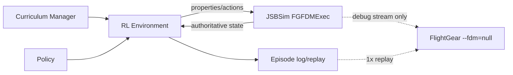

# JSBSim - FlightGear RL Mimarisi

## 1. Sabitlenen karar

| Bileşen | Rol | Eğitim sonucuna etkisi |
|---|---|---|
| JSBSim | Ana ve tek yetkili uçuş dinamiği, reset/step, observation ve action ortamı | Normatif; eğitim ve değerlendirme metriklerinin kaynağı |
| FlightGear | Canlı/replay görselleştirme, insan incelemesi ve debug | Normatif değil; başarı metriği veya state oracle olamaz |
| RL kodu | Curriculum Manager, policy, state estimator, reward/constraint ve episode runner | JSBSim Python API’sini doğrudan kullanır |
| Repo uzantıları | F-16C’ye özgü eksik sistem, sensör ve görev mantığı | JSBSim property katmanının üzerinde, testli ve sürümlenmiş |

FlightGear kapalıyken bütün eğitim ve frozen değerlendirme eksiksiz çalışmalıdır. FlightGear’ın açık veya kapalı olması aynı seed ve action dizisiyle JSBSim durum izini değiştiremez.

## 2. Tek doğruluk kaynağı



Yasak mimari:

- eğitim sırasında JSBSim ve FlightGear’ın ayrı FDM’lerini aynı anda çalıştırmak;
- FlightGear görüntüsü/property tree’sinden gizli veya farklı bir fizik durumu alıp reward hesaplamak;
- FlightGear FPS düşüşünü JSBSim physics step’ine bağlamak;
- FlightGear’da görünen bir animasyonu native JSBSim özelliği saymak.

## 3. Sürüm ve kurulum sınırı

18 Ağustos 2026 tarihli resmî doküman kontrolünde hedef başlangıç sürümleri:

- JSBSim `1.3.1` Python wheel/API;
- FlightGear `2024.1.6` kararlı sürüm;
- FlightGear F-16 görsel paketi: `NikolaiVChr/f16`, `f16-block-50` varyantı.

Bu sürümler kurulum sırasında yeniden doğrulanır ve tam sürüm/commit/hash manifestte sabitlenir. `master`, `latest` veya değişken indirme adresi deney kaydında sürüm olarak kullanılamaz.

Yerel hazır olma anlık görüntüsü:

| Kontrol | Mevcut durum |
|---|---|
| `jsbsim` Python import | kurulu değil |
| `JSBSim`/`jsbsim` CLI | bulunamadı |
| `fgfs` CLI / FlightGear.app | bulunamadı |
| F-16 model paketi | repo içinde bulunmuyor |

Bu belge kurulum veya çalıştırma başarısı iddia etmez.

## 4. F-16 model seçimi kapısı

JSBSim dağıtımındaki `aircraft/f16` modeli, kendi README’sine göre **F-16A Block 15+** temellidir. Bu model M01 kontrol araştırması için bir baseline olabilir fakat F-16C Block 50 doğrulaması değildir.

FlightGear F-16 paketi `f16-block-50` varyantı sunar ve JSBSim tabanlıdır. Ancak paket; FlightGear `-set.xml`, Nasal scriptleri, property tree, cockpit ve başka sim alt sistemlerine bağlanabilir. Bu nedenle paketin adında Block 50 geçmesi, headless JSBSim’de aynı özelliklerin çalıştığını kanıtlamaz.

### FDM-G0 kabul kapısı

Bir FDM kaynağı seçilmeden önce şu kayıt hazırlanır:

1. kaynak repo, commit, lisans ve dosya SHA-256 listesi;
2. aircraft/engine/systems XML dependency closure;
3. standalone `FGFDMExec.load_model()` ve `run_ic()` başarısı;
4. trim matrisi: irtifa x hız x ağırlık x yük konfigürasyonu;
5. 5 dakikalık serbest uçuş/stability ve NaN/inf testi;
6. kontrol işareti, aralık, saturation ve FBW/FCS davranışı;
7. motor spool, afterburner, yakıt ve flameout davranışı;
8. gear, brake, steering, speedbrake ve ground reaction;
9. M01 envelope testleri ve bilinen limitlerle karşılaştırma;
10. FlightGear olmadan bütün testlerin geçmesi.

Karar sırası:

- **Aday A:** FlightGear `f16-block-50` paketinden ayrıştırılmış standalone JSBSim dependency closure.
- **Aday B:** JSBSim `aircraft/f16` Block 15+ baseline; yalnız altyapı ve M01 prototipi.
- **Aday C:** doğrulanmış yeni/uyarlanmış Block 50 FDM; yalnız A başarısız veya yetersizse.

Model doğrulanana kadar raporlarda isim `F-16-like JSBSim baseline` olur; `F-16C Block 50 validated` denmez.

## 5. Ortam API sözleşmesi

RL framework seçimi açık olsa da ortam şu arayüzü sağlamalıdır:

```text
reset(seed, lesson_id, difficulty, options) -> observation, info
step(action) -> observation, reward, terminated, truncated, info
get_state_snapshot() -> versioned replay state
close()
```

### 5.1 Reset sırası

1. Yeni veya temizlenmiş `FGFDMExec` örneği oluştur.
2. Sabitlenmiş aircraft/engine/systems kökünü yükle.
3. Physics `dt` değerini ayarla.
4. Seed’den başlangıç durumu ve domain parametrelerini üret.
5. JSBSim `ic/*` property’lerini yaz.
6. `run_ic()` çağır.
7. Gerekli derste trim veya tanımlı airborne reset uygula.
8. Actuator, filter, state-estimator ve recurrent hidden state’i sıfırla.
9. Warm-up adımlarını policy ödülü olmadan çalıştır.
10. İlk observation ile reset manifestini döndür.

Reset sonrası ilk action verilmeden state değişmemesi, seed tekrar üretimi ve hidden-state sızıntısı otomatik test edilir.

### 5.2 Step sırası

1. Policy action’ı doğrula ve clip öncesi ham değeri günlüğe yaz.
2. Rate limit, deadzone, smoothing, latency queue ve saturation uygula.
3. JSBSim property’lerine gerçekleşen actuator komutunu yaz.
4. Bir policy adımı için `N` physics substep çalıştır.
5. Authoritative JSBSim property’lerinden observation üret.
6. Observation latency/noise/dropout modelini uygula.
7. Hard constraint ve termination kontrollerini çalıştır.
8. Geçerli bölümse shaping/task reward hesapla.
9. `info` içinde ham state, constraint, target ve metric alanlarını döndür.

## 6. L1 Aviator observation sözleşmesi

CORE policy’ye başlangıçta piksel verilmez. Tüm açılar açık birim ve frame tanımıyla normalize edilir.

| Grup | Observation |
|---|---|
| Tutum | roll, pitch, heading için `sin/cos`; body rates `p/q/r` |
| Aerodinamik | alpha, beta, normal load factor, dynamic pressure |
| Hız/enerji | calibrated/true airspeed, Mach, flight-path angle, vertical speed |
| Konum | MSL/AGL irtifa; L1 route aşamasında waypoint-relative north/east/down |
| Propulsion | throttle command/position, engine running, RPM/spool eşdeğeri, fuel |
| Konfigürasyon | gear, speedbrake, wheel-on-ground, brake/NWS durumu |
| Hedef | target roll/bank, pitch, heading, altitude, speed veya vertical speed; active-mask |
| Temporal | previous action, sample age, validity mask, policy `dt` |

Görev hedefleri absolute değer yerine mümkün olduğunda hata, `sin/cos` veya normalize relative vektörle temsil edilir. Reward için kullanılan future waypoint veya hidden truth observation’a eklenmez.

## 7. L1 Aviator action sözleşmesi

| Aşama | Açık action’lar | Öğretmen tarafından tutulanlar |
|---|---|---|
| M01.1 roll stabilization | roll command | pitch, yaw, throttle |
| M01.2 pitch stabilization | pitch command | roll, yaw, throttle |
| M01.3 bank tracking | roll command | pitch/altitude, yaw, throttle |
| M01.4 heading | roll + sınırlı rudder | altitude ve speed |
| M01.5 altitude | pitch + throttle | heading |
| M01.6 airspeed | throttle + pitch | heading |
| M01.7 climb/descent | pitch + throttle | heading |
| M01.8 combined | roll, pitch, rudder, throttle | yok |
| M01.9+ | combined + speedbrake/konfigürasyon gerektiğinde | yalnız ders dışı sistemler |

Normalized policy action ile JSBSim property adı ayrı action-map dosyasında tutulur. Property adı policy koduna gömülmez.

## 8. Başlangıç zamanlama bütçesi

İlk ölçüm profili:

| Katman | Başlangıç değeri | Not |
|---|---:|---|
| JSBSim physics | 120 Hz (`dt=1/120`) | FDM-G0 ile yakınsama testi yapılır. |
| Flight controller policy | 20 Hz | Başlangıç action repeat = 6 physics step. |
| Navigation/skill policy | 2 Hz | Alt hedefler düşük seviyeye iletilir. |
| Mission manager | 1-2 Hz | L1’de kullanılmaz veya deterministiktir. |
| FlightGear stream | 30 veya 60 Hz | Yalnız debug/replay; training clock’tan ayrıdır. |

Physics sonuçları 120/240 Hz ve policy 10/20/40 Hz karşılaştırmasıyla test edilir. Daha hızlı çalışmak tek başına doğruluk değildir; yakınsama, actuator ve reward invariance kapıları geçmelidir.

## 9. Paralel eğitim modeli

- Her worker kendi `FGFDMExec` örneğine sahiptir; global mutable simulator state paylaşılmaz.
- Headless worker’lar FlightGear soketi açmaz.
- Seed üretimi worker sayısından bağımsız episode ID ile yapılır.
- Aynı episode, tek worker ve çok worker koşusunda aynı state hash dizisini üretmelidir.
- GPU policy inference/training için; JSBSim step CPU tarafındadır.
- İlk RTX 3060 profili küçük vektör observation ve M01 policy’siyle başlar; piksel encoder açılmaz.

## 10. FlightGear debug köprüsü

### 10.1 Canlı debug

JSBSim, FlightGear formatında UDP yayınlar. Örnek output directive:

```xml
<output name="localhost" type="FLIGHTGEAR" port="5600" rate="60" protocol="UDP"/>
```

FlightGear iç FDM’i kapalı ve dış FDM dinler durumda başlatılır:

```text
fgfs --fdm=null --native-fdm=socket,in,60,,5600,udp --aircraft=f16-block-50
```

Komut, kurulum ve aircraft path doğrulanmadan çalışır kabul edilmez. Port ve rate config dosyasından gelir; kod içinde sabitlenmez.

### 10.2 Replay debug

Tercih edilen görsel QA, eğitimi yavaşlatmayan replay modudur:

1. episode state/action/target/constraint kaydı oluşturulur;
2. episode ID ile 1x duvar saatinde tekrar oynatılır;
3. JSBSim authoritative state FlightGear’a yayınlanır;
4. FlightGear görüntüsü ile metrik zaman serisi aynı timestamp üzerinde incelenir.

### 10.3 Property debug

FlightGear property tree/telnet/generic protocol yalnız şu işler için kullanılabilir:

- kamera, hava, görünür debug etiketi ve overlay ayarı;
- model/gear/control-surface animasyonunu inceleme;
- cockpit/HUD property bağımlılıklarını teşhis etme.

Bu kanaldan gelen değerler training observation, reward veya frozen-test oracle olamaz. External/null FDM kullanıldığında bazı F-16 cockpit/HUD öğelerinin FlightGear’ın kendi JSBSim/Nasal akışına bağımlı olması beklenen bir entegrasyon riskidir.

## 11. Feature sahipliği

| Feature ailesi | İlk sağlayıcı | Açıklama |
|---|---|---|
| `FLT-*` | JSBSim FDM/FCS | FDM-G0 sonrası `native` olabilir. |
| CORE engine/fuel/gear/brake | JSBSim model properties | Property ve davranış testi gerekir. |
| CORE HUD/gösterge | RL için structured observation; FlightGear görseli | Görüntü doğruluğu L1’i bloklamaz. |
| `PRC-*`, `INS-*`, `NAV-*` | Repo FSM/system extensions + JSBSim state | FlightGear cockpit scripti training dependency olamaz. |
| `FCR-*`, `TGP-*`, `HTS-*`, `DLK-*`, `DEF-*` | İleride repo-native sensor/system simulation | JSBSim temel paketi bunları otomatik sağlamaz. |
| `AA-*`, `AG-*` | İleride sanal görev/etki uzantıları | FlightGear animasyonu/weapon scripti tek başına doğrulama değildir. |
| Kokpit görselleştirme | FlightGear F-16 package | Debug/reference; headless RL’den ayrıdır. |

Kapsam matrisinde bir satır yalnız JSBSim veya repo eğitim katmanında gözlenebilir, eyleme geçirilebilir ve test edilebilir olduğunda `native/adapted` sayılır. FlightGear’da görünmesi yeterli değildir.

## 12. İlk uygulama sırası

1. Kurulum ve sürüm/commit/hash manifesti.
2. FDM-G0 ile Block 50 aday A/B karşılaştırması.
3. `reset/step` iskeleti ve property catalog snapshot.
4. Determinism, units, coordinate frame ve action sign testleri.
5. M01.1 roll stabilization ortamı.
6. Curriculum Manager ile M01.1 zorluk artışı ve frozen test.
7. M01.2-M01.8 atomik/bileşik kontrol.
8. Episode replay formatı.
9. FlightGear native-FDM replay köprüsü.
10. M01.9-M01.12 ve ardından L1 route/takeoff/landing hattı.

## 13. Başlangıç kabul testleri

| Test | Geçiş ölçütü |
|---|---|
| Import/load | pinli JSBSim import, model load ve `run_ic()` başarılı |
| Determinism | aynı manifest/seed/action için state hash dizisi aynı |
| Step isolation | FlightGear açık/kapalı state hash aynı |
| Units/sign | roll/pitch/yaw/throttle property işareti ve birimi golden testle doğru |
| Rate convergence | 120/240 Hz metrik farkı tanımlı tolerans içinde |
| Reset isolation | önceki episode actuator/filter/hidden state sızıntısı yok |
| NaN/inf | nominal ve envelope testlerinde sıfır |
| Replay sync | FlightGear görüntüsü ve episode timestamp’i tolerans içinde |
| Throughput | headless single/multi-worker steps/s raporlanmış; FlightGear dahil değil |

## 14. Kaynaklar

- [JSBSim resmî proje ve Python kullanım kılavuzu](https://github.com/JSBSim-Team/jsbsim)
- [JSBSim FGFDMExec Python API](https://jsbsim-team.github.io/jsbsim/python/FGFDMExec.html)
- [JSBSim properties referansı](https://jsbsim-team.github.io/jsbsim-reference-manual/user/concepts/properties/)
- [JSBSim resmî F-16 model dizini](https://github.com/JSBSim-Team/jsbsim/tree/master/aircraft/f16)
- [JSBSim FlightGear output referansı](https://jsbsim-team.github.io/jsbsim/classJSBSim_1_1FGOutput.html)
- [FlightGear dış FDM/socket arayüzü](https://wiki.flightgear.org/Property_Tree/Sockets)
- [FlightGear güncel kararlı sürüm](https://www.flightgear.org/download/)
- [FlightGear F-16 paket bilgisi](https://wiki.flightgear.org/F16)
- [FlightGear F-16 kaynak deposu](https://github.com/NikolaiVChr/f16)
